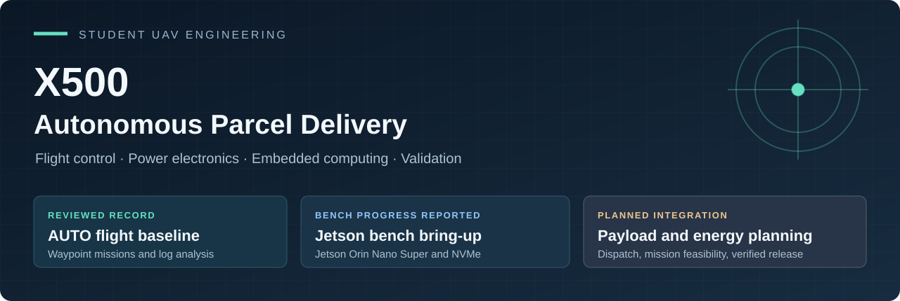
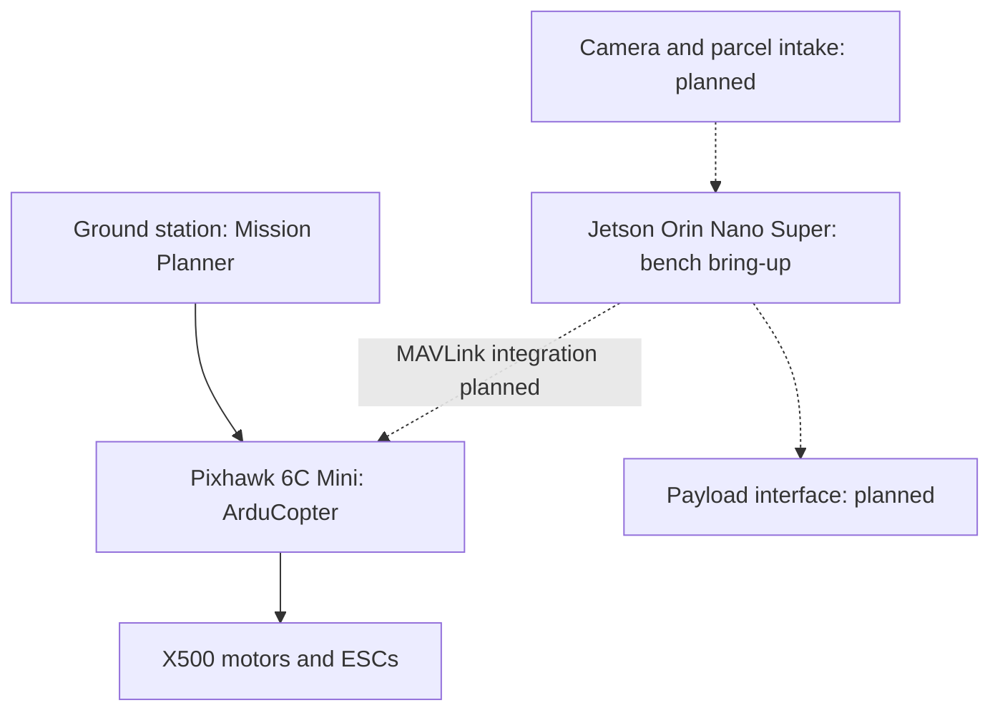

<p align="center"></p>

# X500 Autonomous Parcel Delivery

**An independent student UAV project combining flight control, power electronics, embedded computing, and experimental validation.**

A six-member engineering and computer science team led by **Mohammed Flaeeh (Mohammed F)**, an Electrical and Computer Engineering student at Saint Louis University.

We are developing a supervised autonomous delivery prototype that identifies a parcel, measures its mass, evaluates mission energy and reserve, and verifies controlled placement. The current foundation is an X500 flying programmed waypoint missions. Payload handling and energy-aware delivery are the next integration stages.

**Status: active development · Updated 28 October 2026**

[Engineering results](docs/case-studies/flight-validation.md) · [System architecture](docs/architecture.md) · [Hardware](hardware/README.md) · [Roadmap](docs/roadmap.md) · [Team](docs/team.md)

## What works today

| Capability | Evidence and current status |
| --- | --- |
| X500 AUTO waypoint flight | Documented in the 10 October log review, covering 7 and 9 October flights. The included summary contains **30 armed intervals and 16 intervals with inferred airborne time** across four source logs. |
| Battery voltage adjustment | Project lead reported **16.68 V in Mission Planner and 16.68 V on the multimeter** after adjustment on 19 October. This is one comparison point; current calibration remains open. |
| Jetson / NVMe bring-up | Orin Nano Super and Samsung 1 TB NVMe setup, with **three successful subsequent boots reported**. Aircraft power and MAVLink integration remain to be qualified. |
| Reproducible repository analysis | A dependency-free Python tool regenerates the included flight-summary report. It analyzes the supplied summary CSV; it does not control the aircraft or decode raw flight logs. |

Read the [evidence register](docs/evidence.md) for source dates, confidence levels, and limitations. The complete delivery workflow has **not yet been demonstrated**.

## Engineering work to explore

- **Flight validation and fault investigation.** Separate armed time from inferred flight, identify AUTO evidence, and investigate vibration and mission-end behavior. [Case study →](docs/case-studies/flight-validation.md)
- **Power and measurement.** Preserve the flight-controller supply, qualify a separate companion-computer branch, and distinguish voltage agreement from energy calibration. [Case study →](docs/case-studies/power-and-compute.md)
- **Design decisions.** Move from the Mark4 development platform to the X500, select the Jetson, and reduce the first delivery demonstration to a testable scope. [Decision record →](docs/decisions.md)

The next technical contribution is an **explainable mission-feasibility decision**: predicted energy, return reserve, and a clear reason to accept or reject a parcel mission. A second contribution is **verified payload handling**, where a release command and physical separation are separate events. Both are development goals.

## System at a glance

The Pixhawk runs flight control and configured flight failsafes. The Jetson is intended to handle perception and mission decisions; the laptop provides operator approval and review.



Solid connections describe the established flight system. Dotted connections describe intended integrations. See the [power tree and interface boundaries](docs/architecture.md).

## Reproduce the included analysis

Requires Python 3.10 or newer; no extra packages or aircraft connection.

From the repository root:

```bash
python analysis/summarize_segments.py
python -m unittest discover -s tests -v
```

The first command prints a report. To regenerate the checked-in outputs:

```bash
python analysis/summarize_segments.py --write
python analysis/summarize_segments.py --check
```

On Windows, use `py -3` in place of `python` if needed.

[View the generated report](analysis/results.md) · [Inspect the CSV](data/flight_segment_summary_2026-10-10.csv) · [Data dictionary](data/README.md)

The original extraction used relative altitude above 2 m as its airborne heuristic. Summed airborne time is **not battery endurance**. Mode lists alone do not prove mission completion, and this dataset cannot establish energy use.

## Next milestones

1. Close the unloaded-flight baseline: current calibration, vibration review, and configuration-specific failsafe evidence.
2. Qualify the Jetson power branch and MAVLink link on the bench.
3. Demonstrate scan → weigh → validate → propose → approve with simulated aircraft interfaces.
4. Validate payload retention and supported release.
5. Progress through simulation, secured inert-load flight tests, and an integrated delivery demonstration.

[Roadmap and acceptance evidence](docs/roadmap.md) · [Validation plan](docs/validation-plan.md)

## Team

The workstreams below follow the project scope, with assignments updated on 28 October 2026. See [team roles and affiliations](docs/team.md) for details and documented contributions.

| Member | Workstream |
| --- | --- |
| Mohammed Flaeeh (Mohammed F) | Project lead; systems integration, flight validation, and energy modeling (with Jad) |
| Jad Khdeer | Power electronics, custom power-module PCB, and energy modeling (with Mohammed F) |
| Ahmad Hamzeh | Package QR/barcode labels, Jetson camera label reading, and destination flight-path planning (with Mohammed A) |
| Alend Barwary | Weighing / dispatch station and instrumentation |
| Yazan Ramadan | Payload fixture, attachment interface, and structural testing |
| Rizan Mohammed Althaff (Mohammed A) | Package QR/barcode labels and destination flight-path planning (with Ahmad); mission state machine, operator interface, and event logging |

## Repository guide

| Area | Contents |
| --- | --- |
| [`docs/`](docs/README.md) | Architecture, case studies, decisions, history, evidence, and development plan |
| [`hardware/`](hardware/README.md) | Documented hardware inventory and power-integration requirements |
| [`software/`](software/README.md) | Current analysis tooling and proposed software responsibilities |
| [`data/`](data/README.md) | Historical flight-summary CSV and provenance |
| [`analysis/`](analysis/results.md) | Reproducible summary script and generated outputs |
| [`tests/`](tests/test_summarize_segments.py) | Input validation and analysis regression tests |

This repository documents team engineering work and its limitations. ArduPilot, Mission Planner, and NVIDIA software are third-party platforms; see [attribution](ATTRIBUTION.md). Documentation and the offline summary tool were assembled with AI assistance from the project records.

For team workflow, see [CONTRIBUTING.md](CONTRIBUTING.md). New to GitHub? Start with the [owner's guide](docs/github-guide.md).
