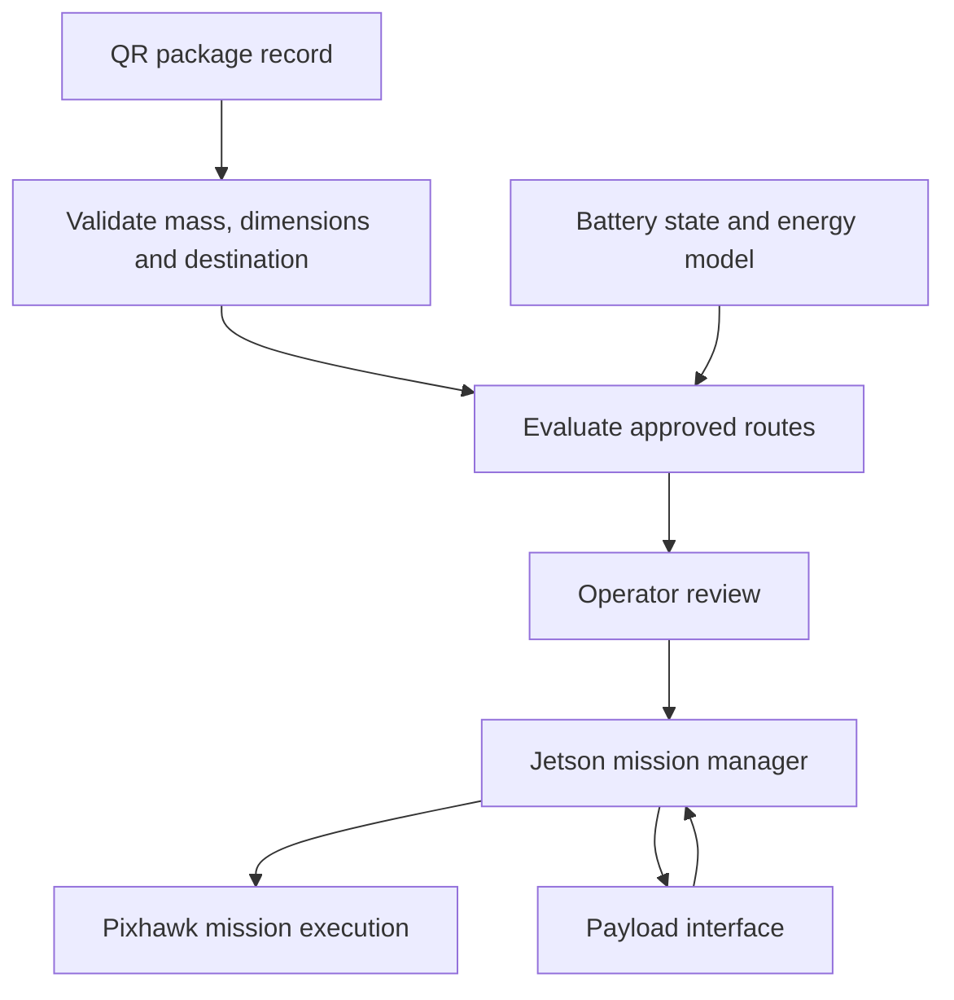

# System architecture

## Flight and companion computers

The flight platform is the Holybro X500 V2 with Pixhawk 6C Mini and ArduPilot. ArduCopter 4.7.1 is recorded in the October review; a current parameter export remains to be added.

The Pixhawk executes flight control and uploaded missions. The Jetson Orin Nano Super is intended to run perception, package processing and mission planning, communicating with the Pixhawk through MAVLink. Mission Planner has been used for configuration and flight review. [ArduPilot companion-computer reference](https://ardupilot.org/dev/docs/companion-computers.html)

## Power

The established flight path is **battery → PM02 V3 → original X500 PDB → ESCs**, with the Pixhawk supplied by the PM02.

A temporary custom Jetson power solution is being developed. Its final wiring, ratings and test results are not yet recorded here. Jad's PCB is intended to combine propulsion distribution, flight-controller supply, battery sensing and regulated companion/peripheral power, replacing the existing module, PDB and temporary supply after qualification.

Keep the present wiring and the proposed PCB as separate revisions. Changes to either need measured rail/load behavior and updated mass and energy records. See [hardware](../hardware/README.md).

## Planned delivery flow

This is the intended integration, not a completed capability.

1. Generate a QR label from package ID, mass, dimensions and an approved destination ID.
2. Read it with the Jetson camera; validate the record and cross-check actual package mass and fit.
3. Reject incompatible packages; evaluate permitted route candidates using the energy model.
4. Select a feasible candidate, show predicted consumption/reserve and reasons, and obtain operator approval.
5. Upload and verify the mission; monitor aircraft and payload state.
6. Confirm supported placement and physical release, complete the approved return/landing, and compare predicted with measured energy.

Route choice and energy feasibility are evaluated together. The first version uses a single parcel and predefined approved routes/sites. It does not require arbitrary obstacle avoidance, airborne pickup or multi-UAV coordination.

## Interfaces to agree before integration

| Interface | Minimum information |
| --- | --- |
| Label software → Jetson | Schema version, package ID, mass in kg, dimensions in mm, approved destination ID |
| Measurements → validator | Actual gross package mass, timestamp, measurement validity |
| Energy model → planner | Predicted Wh by mission phase, uncertainty allowance, reserve, model version and applicable conditions |
| Planner → operator | Selected route, accept/reject reasons, battery estimate and tested limits |
| Mission manager ↔ Pixhawk | Approved mission, upload confirmation, telemetry timestamps, mission progress and contingency state |
| Mechanical system → mission manager | Attached, supported, released or unknown; observation time and faults |

A label is package data, not permission to fly. Mission acknowledgments do not prove physical release. Stale or missing required data blocks automatic acceptance.

Details: [package workflow](package-workflow.md), [energy model](energy-model.md), [validation](validation-plan.md).
