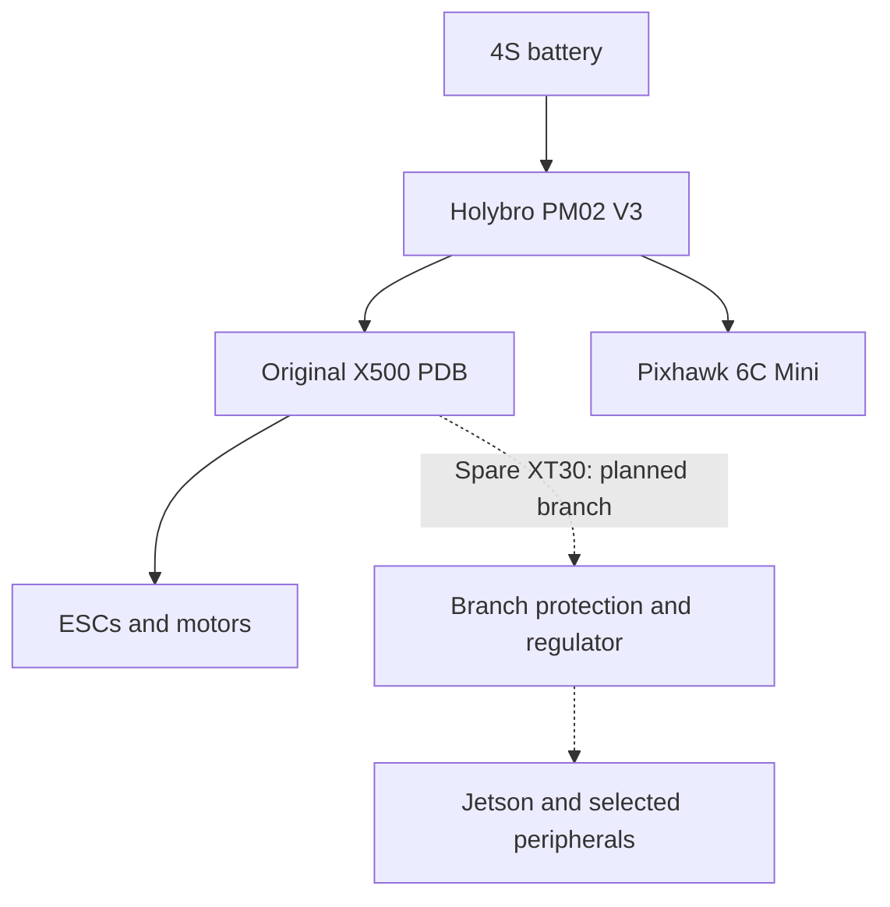

# System architecture

Last documented: 28 October 2026.

## Established flight platform

The X500 V2 ARF uses a Pixhawk 6C Mini, M9N GPS, RadioMaster control link, PM02 V3, original X500 distribution board, and a Tattu 4S 5200 mAh battery. ArduCopter 4.7.1 is the version recorded in the October flight review.

The flight controller executes flight control and uploaded missions. Mission Planner provides configuration, mission planning, and telemetry review. The Jetson is a companion computer; it does not replace the flight controller. ArduPilot documents MAVLink as the companion-computer interface. [Reference](https://ardupilot.org/dev/docs/companion-computers.html)

## Power topology

The battery → PM02 V3 → original PDB → ESC path and PM02-to-Pixhawk supply are documented project wiring. The auxiliary branch is a design under evaluation. A specific regulator, protective-device rating, connector loading, and final output rail are not approved by this repository.

Jad's custom power-board work is a parallel development stream. Replacing the propulsion distribution or Pixhawk supply requires separate qualification; it is not assumed in the first Jetson installation.

## Planned mission flow

1. Each package carries a QR code or barcode label that stores its payload information: contents/package ID, dimensions, weight, and destination.
2. The Jetson camera reads the label and decodes the payload record.
3. Validate the record: the destination must match an approved delivery site, and the measured gross parcel mass (including the attachment target) must agree with the labelled weight within an agreed tolerance.
4. Check dimensions, packaging, and the tested vehicle envelope.
5. Plan and optimize the flight path to the labelled destination within approved routes and limits.
6. Predict loaded outbound energy, placement energy, unloaded return energy, uncertainty, and reserve for the planned path.
7. Obtain operator approval; upload and verify the mission.
8. Transport the parcel, confirm support or landing, authorize release, and verify separation.
9. Complete the approved return or landing and compare predicted with measured energy.

The first demonstration uses manual parcel loading and one approved delivery area. Airborne pickup, multi-stop delivery, and coordinated Mark4 operations are extensions.

## Proposed interface contract

These are design requirements, not implemented APIs.

| Interface | Data / behavior to define |
| --- | --- |
| Package label → Jetson | Label format and version; package ID, dimensions in m, labelled weight in kg, destination; checksum or signature |
| Label reader → planner | Decoded payload record, approved destination ID, measured mass in kg, read confidence, validation status |
| Planner → mission manager | Optimized flight path to the destination, route constraints applied, predicted energy for that path |
| Planner → operator | Route ID, speed limits in m/s, predicted energy and reserve in Wh, model version, accept/reject reasons |
| Operator / mission manager → autopilot | Approved mission, upload verification, acknowledgments, actual flight state |
| Payload mechanism → mission manager | Attached, supported, released, or unknown; observation timestamp; fault state |
| All subsystems → event record | Mission ID, subsystem version, timestamps with an agreed timebase, state changes, acknowledgments |

Agree timeout and stale-data behavior before integration. A label does not authorize arbitrary navigation commands: its destination is used only if it resolves to an approved delivery site, and the planned path still requires operator approval. A command acknowledgment does not establish physical attachment or release.

## Open integration items

- Select and bench-qualify auxiliary power, including startup and load-step behavior.
- Verify the physical MAVLink connection, electrical details, message configuration, and link-loss behavior for the actual hardware.
- Define the package label format (QR/barcode payload fields, units, versioning, integrity check).
- Select a camera and measure the complete compute/peripheral load.
- Decide payload retention mechanism and independent state sensing.
- Capture actual JetPack/Jetson Linux versions and a dated aircraft parameter export.

See [validation](validation-plan.md) and [hardware](../hardware/README.md).
