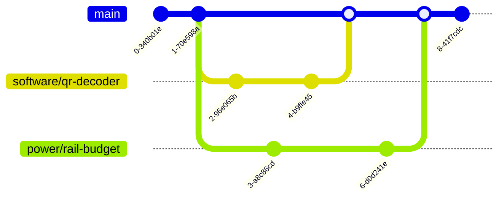

# Git and GitHub tutorial

Six people are changing the same project: PCB files, CAD, Jetson code, the energy model and the docs. Git keeps a full history of every change. GitHub is where we share those changes and review them before they reach `main`. This guide covers what you need, in the order you'll need it.

[CONTRIBUTING.md](../CONTRIBUTING.md) and the [GitHub guide](github-guide.md) hold the repository's rules. If this tutorial and those files disagree, those files win.

**Contents:** [Big picture](#1-the-big-picture) · [Words](#2-words-youll-hear) · [Setup](#3-one-time-setup) · [Daily loop](#4-the-daily-loop) · [Branches](#5-why-branches-matter) · [Pull and push](#6-pull-push-ahead-and-behind) · [Pull requests](#7-pull-requests-and-review) · [Merge conflicts](#8-merge-conflicts) · [Team rules](#9-team-rules) · [Software work](#10-for-software-work) · [Hardware work](#11-for-hardware-work) · [Fixing mistakes](#12-when-things-go-wrong) · [Cheat sheet](#13-cheat-sheet) · [First exercise](#14-first-exercise)

## 1. The big picture

**Git** is a program on your computer that records snapshots of a folder. **GitHub** is a website that hosts a shared copy of that folder so the whole team can sync with it. Git works offline. GitHub is where collaboration happens.

Your work lives in two places at once:

| Your laptop (local) | | GitHub (remote, "origin") |
| --- | :---: | --- |
| Your clone of the repo. You edit and commit here. Nobody else can see it until you push. | **push →**<br>**← pull** | The shared copy. Everyone pushes to it and pulls from it. Pull requests and reviews happen here. |

Almost every Git problem comes down to these two copies being out of sync.

### Branch vs. `main`

`main` is the version of the project everyone trusts. A branch is your own copy where you can work without affecting anyone else.

Think of the aircraft: `main` is the X500 that we know flies. Nobody tests a new part straight on that drone. You test the new power board on the bench first (your branch). When it's proven and someone else has checked it, it goes on the aircraft (merged into `main`).

## 2. Words you'll hear

| Term | What it means |
| --- | --- |
| Repository (repo) | The project folder plus its full history. |
| Clone | Download a repo to your computer, including its history. You do this once. |
| Commit | A saved snapshot of your changes with a message explaining them. A save point you can always return to. |
| Branch | A separate line of commits. You work on your own branch so `main` stays stable. |
| `main` | The official version of the project. Only reviewed work gets into it. |
| Push | Upload your local commits to GitHub. |
| Pull | Download new commits from GitHub and add them to your local copy. |
| Pull request (PR) | A request to merge your branch into `main`. Teammates review it there first. |
| Merge | Combine the commits from one branch into another. |
| Merge conflict | Two branches changed the same lines differently, and Git needs a person to decide which version is right. |
| Remote / origin | The GitHub copy of the repo. `origin` is its default nickname. |
| Staging | Choosing which changed files go into the next commit (`git add`). |
| Issue | A task or bug tracked on GitHub. Each piece of work should start as one. |
| Code owner | A person listed in [`.github/CODEOWNERS`](../.github/CODEOWNERS) whose approval a PR needs before it can merge. |
| Check (CI) | An automatic test GitHub runs on every PR. Ours is called `summary`. |

## 3. One-time setup

1. Make a GitHub account and send your username to Mohammed F so you can be added to the **x500-delivery** organization.
2. Install [Git](https://git-scm.com/downloads) and [VS Code](https://code.visualstudio.com/). In VS Code, sign in to GitHub from the Accounts icon (bottom left).
3. Tell Git who you are. Use the email on your GitHub account so commits are credited to you.

```bash
git config --global user.name "Your Full Name"
git config --global user.email "you@example.com"
```

Then clone the repo and open it in VS Code:

```bash
git clone https://github.com/x500-delivery/x500-autonomous-delivery-system.git
cd x500-autonomous-delivery-system
code .
```

> **Prefer clicking?** VS Code's Source Control panel (the branch icon on the left) does commit, push, pull and branch switching with buttons. The commands in this guide show what those buttons do.

## 4. The daily loop

Every change, from a one-line doc fix to a new PCB revision, goes through the same steps.

**1. Start from an issue.** Open or pick a small issue that says what you're doing, who owns it and how you'll show it's done.

**2. Pull the latest `main`.** Start from what everyone else already has. This one step prevents most conflicts.

```bash
git switch main
git pull --ff-only
```

**3. Create your branch.** Name it `area/short-description`, for example `power/rail-budget` or `software/qr-decoder`. Name it after the work, not after yourself.

```bash
git switch -c software/qr-decoder
```

**4. Make changes and commit.** Commit each logical step with a message that says what changed. Small commits are easier to review and easier to undo.

```bash
git status                       # see what changed
git add software/qr_decoder.py   # stage the files you mean to commit
git commit -m "Decode package ID and mass from QR label"
```

**5. Push your branch.** The first push needs `-u` so Git remembers where the branch goes. After that, plain `git push` works.

```bash
git push -u origin software/qr-decoder
```

**6. Open a pull request.** GitHub shows a "Compare & pull request" button after you push. Fill in the template (Change, Validation, Credit and status) and link the issue.

**7. Review, fix, merge.** A code owner reviews the PR. If they ask for changes, commit and push to the *same branch* and the PR updates itself. Once it's approved and the `summary` check passes, merge it.

**8. Clean up.** Delete the branch on GitHub (there's a button on the merged PR), then go back to step 2 for your next task.

```bash
git switch main
git pull --ff-only
git branch -d software/qr-decoder
```

## 5. Why branches matter

If everyone edited `main` directly, a half-finished change by one person would break things for the other five. A branch gives you a private line of work. You can experiment, push unfinished work as a backup, and get it reviewed. `main` only changes when a finished, reviewed PR is merged.



Each dot is a commit. Two people work at the same time on separate branches, and each branch joins `main` through its own reviewed PR.

### Keep branches short-lived

One branch per task, merged within a few days. The longer a branch lives, the further `main` moves away from it and the more likely you'll hit conflicts. If a task is big, split it into several small PRs.

> **About `patch-1` style names:** editing a file in the GitHub website creates a branch like `yourname-patch-1`. That's fine for a quick fix, but give it a descriptive name when you can, and delete it after the PR merges.

## 6. Pull, push, ahead and behind

**Pull before you start working** and before you create a branch. If you skip it, you'll build on an old version and run into conflicts later. We use `git pull --ff-only` on `main`. It refuses to do anything surprising: if your local `main` somehow has commits GitHub doesn't, it stops and tells you instead of creating a messy merge.

**Push at least once a day** while you're working, even if the work isn't finished. Pushed work is backed up and visible to teammates. Work that only exists on your laptop is lost if the laptop is.

GitHub's Branches page compares every branch to `main` in commits:

| Number | Meaning | What to do |
| --- | --- | --- |
| Ahead | Commits on your branch that `main` doesn't have yet. Your new work. | Get it into a PR. |
| Behind | Commits on `main` your branch doesn't have. Other people's merged work. | If it's large, update your branch from `main` before merging. |
| Ahead = 0 | Everything on this branch is already in `main`. | Safe to delete. |

To bring a branch up to date with `main`, use the **Update branch** button on the PR, or locally:

```bash
git switch main
git pull --ff-only
git switch software/qr-decoder
git merge main        # fix any conflicts, then:
git push
```

## 7. Pull requests and review

A PR is where your change gets a second pair of eyes before it becomes part of the project. On this repo, `main` is protected. A PR can only merge when all three of these are true:

- **One code owner approved it.** You can't approve your own PR.
- **The `summary` check passed.** It runs the analysis tests automatically. A red ✗ means something broke. Click "Details" to see what.
- **Every review conversation is resolved.**

These rules apply to admins too. Pushing new commits after an approval dismisses it, so the reviewer looks again at what actually merges.

### Writing a good PR

- **Small.** One task. Under a few hundred lines when you can. Big PRs get skimmed, small ones get reviewed.
- **Clear title.** "Add rail budget for Jetson 5 V supply" instead of "updates".
- **Filled-in template.** What changed and why, how you tested it, who helped, and whether it's a plan, a bench result or a flight result.

### Reviewing a teammate's PR

- Open the **Files changed** tab and click a line to comment on it.
- Ask questions when something is unclear. "Where does this 16.68 V figure come from?" is a useful review comment.
- Be specific and kind. Comment on the change, not the person.
- Finish with **Approve** or **Request changes**.

## 8. Merge conflicts

A conflict happens when two branches change **the same lines of the same file** in different ways. Git merges everything it can by itself. When both sides touched the same line, it can't know which version is correct, so it stops and asks you.

Conflicts are normal. Nothing is broken and nothing is lost. Git just needs a human decision.

### What a conflict looks like

Say `main` changed Alend's role in `docs/team.md`, and your branch changed the same line. Git writes both versions into the file between markers:

```text
<<<<<<< HEAD
| Alend Barwary | Weighing station and instrumentation |
=======
| Alend Barwary | Jetson–Pixhawk communication and mission integration |
>>>>>>> main
```

- `<<<<<<< HEAD` starts **your** version (the branch you're on).
- `=======` separates the two versions.
- `>>>>>>> main` ends **their** version (the branch being merged in).

Your choices, and what each one means here:

| Choice | Result in this example |
| --- | --- |
| Accept current (yours) | Throws away the newer role from `main`. Wrong here. |
| Accept incoming (`main`) | Keeps the agreed, newer role. Correct here. |
| Accept both | Alend appears twice with two roles. Only right when both lines should stay, like two new rows. |
| Combine by hand | Valid if the team agreed on a combined role. Check with the people involved first. |

### How to resolve one in VS Code

1. Open the file. VS Code highlights each conflict and shows buttons above it: *Accept Current*, *Accept Incoming*, *Accept Both*.
2. Choose one, or edit the text by hand so it's correct. **Delete all the marker lines.**
3. Save, then stage and commit:

```bash
git add docs/team.md
git commit -m "Merge main and resolve team role conflict"
git push
```

For simple text conflicts, GitHub also has a **Resolve conflicts** button on the PR page.

> **When in doubt, ask.** If the conflict is in someone else's area, message them before choosing. Picking the wrong side silently deletes their work. Never commit a file that still contains `<<<<<<<` markers.

### How to avoid conflicts

- Pull `main` before starting any new branch.
- Keep branches small and merge them quickly.
- Say in the issue which files you're changing, so two people don't rewrite the same section at once.
- Don't reformat or reorder whole files as part of an unrelated change.

## 9. Team rules

**Do**

- Pull `main` before you start.
- Use one branch per task, named `area/description`.
- Write commit messages that say what changed: "Add 5 V rail current limit".
- Push daily, even unfinished work.
- Open small PRs and link the issue.
- Run the tests before opening a PR that touches the analysis.
- Delete your branch after it merges.
- Label results honestly: plan, simulation, bench or flight.

**Don't**

- Commit passwords, API keys, Wi‑Fi credentials or private flight locations. Once pushed, assume they're public.
- Use messages like "update", "fix" or "asdf".
- Commit huge binaries (videos, raw logs) without asking first.
- Force-push (`git push --force`) to a branch someone else is using.
- Mix unrelated changes in one PR.
- Approve a PR you didn't actually read.
- Leave a PR open for weeks. Finish it or close it.

The tests for the analysis tool:

```bash
python -m unittest discover -s tests -v
python analysis/summarize_segments.py --check
```

## 10. For software work

The software side uses the full workflow every day: branches, PRs, reviews, conflicts and CI. Each person's code feeds the next person's, so the hand-offs matter as much as the code.

| Person | Writes | Hands off to |
| --- | --- | --- |
| Mohammed A | Package-label format, QR generator, validator | Ahmad (decoding) and Alend (validated destination) |
| Ahmad | Jetson camera and decoding pipeline, Jetson environment setup | Alend (validated record → mission) |
| Alend | Flight-path generation, MAVLink mission upload, execution monitoring | The Pixhawk |
| Mohammed F | Energy model and analysis code, plus reviewing and admin | Alend (route feasibility) |

When a change touches a hand-off, such as a field in the package label or the energy model's output, ask the person on the other side of it to review the PR.

## 11. For hardware work

Hardware work belongs on GitHub too, even when none of it is code. You use it differently from the software side, and you don't need to learn all of Git.

| Who | What goes in the repo | Why it's useful |
| --- | --- | --- |
| Jad | KiCad schematic and PCB files, BOM, power tree and rail budget, bench test records | Every board revision is saved with a note on what changed. The software side can read the rail limits they design against. |
| Yazan | CAD source files plus PDF/STEP exports, payload mass and center of gravity, test records | Alend and Mohammed F need the payload limits for mission planning. Everyone can see the current mount design without SolidWorks. |
| Both | Issues for their tasks, updates in `docs/`, measurements in `data/` | One place for the team to see progress, blockers and evidence. |

Hardware files go under `hardware/`. Add a subfolder such as `hardware/power/` or `hardware/mechanical/` with its first real file.

### What you get, even without code

- **Version history.** You always know which board revision or mount design is current and why it changed. No more `pcb_final_v3_REAL.kicad_pcb`.
- **Evidence.** Test records and measurements are tied to dates and to the people who did the work. That's how we show what's reported and what's actually demonstrated.
- **Interfaces.** Hardware decisions affect software. If the Jetson's supply voltage changes, that goes through a PR that Ahmad and Alend can see.
- **Credit.** Your name is on every commit. Useful for résumés and portfolios.

### What's different about hardware files

- **CAD and most PCB files can't be merged.** Git can't combine two people's edits to a SolidWorks part the way it combines text. If two people edit the same file at once, one person's work gets thrown away.
- **KiCad is partly an exception.** Its files are text, so you can see some differences, but merging two people's layout changes still isn't practical.
- **Always add a readable export.** A PDF of the schematic, or STEP/PDF drawings for CAD, so reviewers can open them in the browser without the design software.
- **Keep big files out.** Videos, raw flight logs and huge CAD assemblies slow the repo down for everyone. Link them from a shared drive or attach them to a GitHub Release.

> **One editor per file.** Before you edit a CAD or PCB file, say so in its issue. Nobody else edits that file until your PR merges.

### The browser-only workflow

No command line needed. The GitHub website does branch, commit, PR and merge for you.

1. **Update your issue:** progress, blocker, next step.
2. **Upload your files.** Go to your folder under `hardware/` and click **Add file → Upload files**. Drag in the KiCad or CAD file plus its PDF export.
3. **Start a pull request.** Choose **Create a new branch for this commit and start a pull request**, give the branch an `area/description` name, write what changed, and submit.
4. **Review and merge.** A code owner reviews it and it gets merged, the same as any other PR.

Hardware members should still read [the big picture](#1-the-big-picture), [why branches matter](#5-why-branches-matter) and [pull requests and review](#7-pull-requests-and-review). The command-line and merge-conflict sections are optional for them.

## 12. When things go wrong

Almost nothing in Git is permanent until it's pushed.

**I made changes on `main` by accident (not committed yet).** Create a branch now. Your uncommitted changes come with you.

```bash
git switch -c docs/my-change
```

**I committed on `main` by accident (not pushed).** Make a branch at your commit, then reset local `main` back to GitHub's version. If you tried to push, GitHub will have rejected it anyway because `main` is protected.

```bash
git branch docs/my-change
git reset --hard origin/main
git switch docs/my-change
```

**Push was rejected: "Updates were rejected because the remote contains work…"** Someone pushed to your branch since you last pulled. Pull first, fix any conflicts, then push.

```bash
git pull
git push
```

**I want to undo my uncommitted changes to one file.** This discards those edits for good, so be sure first.

```bash
git restore path/to/file
```

**I need to undo a commit that's already pushed or merged.** Don't rewrite history. Create a new commit that reverses it, then open a PR as usual.

```bash
git revert <commit-id>
```

**I wrote the wrong commit message (not pushed).**

```bash
git commit --amend -m "Better message"
```

**I'm in the middle of a merge and want to start over.**

```bash
git merge --abort
```

**I committed a password or key.** Tell Mohammed F right away and **change the password or revoke the key**. Deleting it in a new commit isn't enough, because it stays in the history.

## 13. Cheat sheet

| Command | What it does |
| --- | --- |
| `git status` | What changed, and which branch you're on |
| `git switch main` | Go to the main branch |
| `git pull --ff-only` | Get the latest from GitHub |
| `git switch -c area/name` | Create a branch and switch to it |
| `git add <file>` | Stage a file for the next commit |
| `git commit -m "message"` | Save a snapshot |
| `git push -u origin area/name` | First push of a new branch |
| `git push` | Push again after that |
| `git log --oneline` | Short history of commits |
| `git diff` | See exact uncommitted line changes |
| `git branch` | List your local branches |
| `git merge main` | Bring main's changes into your branch |

## 14. First exercise

Everyone should do this once in the first week. It goes through the whole loop on a harmless change.

1. Clone the repo and pull `main`.
2. Create a branch named `docs/yourname-practice`.
3. In `docs/team.md`, fix a typo or add one sentence to your own entry.
4. Commit with a clear message and push the branch.
5. Open a PR, fill in the template and request a review from a code owner.
6. Respond to one review comment with a new commit.
7. Once it's approved, merge it and delete the branch.

**Bonus, in pairs:** two people each change the same line of the same file on separate branches. Merge one PR, then resolve the conflict on the other. After doing it once on purpose, conflicts stop being scary.
